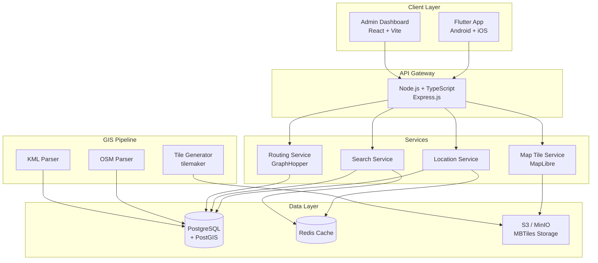

# IITJ Maps — Implementation Plan

## Overview

Build a production-grade campus navigation app for IIT Jodhpur with interactive maps, GPS tracking, smart search, walking navigation with turn-by-turn directions, and offline support. The app targets Android + iOS via Flutter, backed by a Node.js/TypeScript API and PostgreSQL/PostGIS database.

### Available Data Analysis

| File | Size | Contents |
|------|------|----------|
| `map.osm` | 1MB, 13,252 lines | Full OSM XML export — nodes, ways, relations covering campus roads, footpaths, buildings, boundaries. Bounding box: `26.4585°N–26.4868°N, 73.1076°E–73.1260°E` |
| `Phase 3B.kml` | 39KB, 1,290 lines | 16 placemarks: 4-Wheeler Parking, 2-Wheeler Parking, Proposed Hostels (×2), Dining Halls (D-5, D-6), Admin Building, Tech Park, Visitors Hostel, Type B/C/D Housing, Academic Block, Auditorium, Skating Ring, Admin Wing, LHB Site |
| `iitj-maps.zip` | 218KB | Additional map data (to be extracted) |

---

## Decisions Confirmed

- ✅ **MapLibre** (free, open-source) — no API key needed
- ✅ **GraphHopper** for pedestrian routing
- ✅ **Free hosting stack**: Supabase (PostgreSQL+PostGIS), Render.com (backend), Vercel (admin dashboard)
- ✅ **No authentication** in MVP — add later
- ✅ **All buildings** from OSM + KML shown with proper labels (including "Proposed" ones)
- ✅ **Core features only** — no bus tracking, no cycling, no AI features in MVP

## Resolved Questions

1. ~~Cycling routes~~ → Walking only for MVP
2. ~~Bus tracking~~ → Deferred to v2
3. ~~Proposed buildings~~ → **Show all** with proper labels from both OSM and KML
4. Timeline → Execute as fast as possible

---

## System Architecture



---

## Tech Stack

### Mobile App (Flutter)
| Component | Choice | Rationale |
|-----------|--------|-----------|
| Framework | Flutter 3.x | Single codebase, native performance |
| State Mgmt | flutter_bloc | Predictable, testable, industry standard |
| Map Renderer | maplibre_gl | Free, open-source, offline MBTiles support |
| HTTP | dio | Interceptors, retry, cancellation |
| Local DB | drift (SQLite) | Type-safe, reactive, offline-first |
| DI | get_it + injectable | Compile-time safe dependency injection |
| Navigation | go_router | Declarative, deep linking support |
| Location | geolocator + permission_handler | Cross-platform GPS |

### Backend
| Component | Choice | Rationale |
|-----------|--------|-----------|
| Runtime | Node.js 20 LTS + TypeScript | Fast I/O, strong typing |
| Framework | Express.js + tRPC | Type-safe API layer |
| Database | PostgreSQL 16 + PostGIS 3.4 | Spatial queries, mature ecosystem |
| Cache | Redis 7 | Search cache, session store |
| Routing Engine | GraphHopper (self-hosted) | Pedestrian profiles, custom weighting |
| Tile Server | martin (Mapbox Vector Tiles) | Rust-based, fast, PostGIS-native |
| Auth | JWT + bcrypt | Stateless, scalable |
| Validation | zod | Runtime type checking |

### GIS Pipeline
| Component | Choice | Rationale |
|-----------|--------|-----------|
| OSM Parser | osmium-tool + Node.js osm-pbf-parser | Extract campus features |
| KML Parser | @tmcw/togeojson | KML → GeoJSON conversion |
| Tile Gen | tilemaker | OSM → MBTiles offline tiles |
| Geocoding | Nominatim (self-hosted, campus-only) | Offline address lookup |

### Infrastructure
| Component | Choice |
|-----------|--------|
| Database | Supabase (free PostgreSQL + PostGIS) |
| Backend Host | Render.com (free tier) |
| Admin Host | Vercel (free tier) |
| Tile Storage | Supabase Storage or Render static |
| Containers | Docker (local dev) |
| CI/CD | GitHub Actions |

---

## Database Schema

```sql
-- Core location/place data
CREATE TABLE categories (
    id          SERIAL PRIMARY KEY,
    name        VARCHAR(100) NOT NULL,  -- 'hostel', 'department', 'cafe', etc.
    icon        VARCHAR(50),
    color       VARCHAR(7),
    sort_order  INT DEFAULT 0,
    created_at  TIMESTAMPTZ DEFAULT NOW()
);

CREATE TABLE places (
    id              SERIAL PRIMARY KEY,
    osm_id          BIGINT UNIQUE,
    name            VARCHAR(255) NOT NULL,
    name_hi         VARCHAR(255),           -- Hindi name
    description     TEXT,
    category_id     INT REFERENCES categories(id),
    geometry        GEOMETRY(GEOMETRY, 4326) NOT NULL,  -- point or polygon
    centroid        GEOMETRY(POINT, 4326),               -- for quick lookups
    floor_count     SMALLINT,
    is_accessible   BOOLEAN DEFAULT true,
    is_active       BOOLEAN DEFAULT true,
    metadata        JSONB DEFAULT '{}',     -- hours, phone, website, etc.
    search_vector   TSVECTOR,               -- full-text search
    created_at      TIMESTAMPTZ DEFAULT NOW(),
    updated_at      TIMESTAMPTZ DEFAULT NOW()
);

CREATE INDEX idx_places_geometry ON places USING GIST(geometry);
CREATE INDEX idx_places_centroid ON places USING GIST(centroid);
CREATE INDEX idx_places_search ON places USING GIN(search_vector);
CREATE INDEX idx_places_category ON places(category_id);

-- Road/path network for routing
CREATE TABLE edges (
    id          SERIAL PRIMARY KEY,
    osm_id      BIGINT,
    name        VARCHAR(255),
    highway     VARCHAR(50),    -- 'footway', 'path', 'residential', etc.
    surface     VARCHAR(50),
    lit         BOOLEAN,
    geometry    GEOMETRY(LINESTRING, 4326) NOT NULL,
    length_m    FLOAT,
    is_covered  BOOLEAN DEFAULT false,
    created_at  TIMESTAMPTZ DEFAULT NOW()
);

CREATE INDEX idx_edges_geometry ON edges USING GIST(geometry);

-- Aliases for fuzzy search ("LHC" → "Lecture Hall Complex")
CREATE TABLE place_aliases (
    id          SERIAL PRIMARY KEY,
    place_id    INT REFERENCES places(id) ON DELETE CASCADE,
    alias       VARCHAR(255) NOT NULL,
    alias_type  VARCHAR(20) DEFAULT 'abbreviation' -- 'abbreviation', 'nickname', 'old_name'
);

-- Admin users
CREATE TABLE admin_users (
    id              SERIAL PRIMARY KEY,
    email           VARCHAR(255) UNIQUE NOT NULL,
    password_hash   VARCHAR(255) NOT NULL,
    name            VARCHAR(100),
    role            VARCHAR(20) DEFAULT 'editor', -- 'editor', 'admin'
    is_active       BOOLEAN DEFAULT true,
    created_at      TIMESTAMPTZ DEFAULT NOW()
);

-- Audit log for admin changes
CREATE TABLE audit_log (
    id          SERIAL PRIMARY KEY,
    admin_id    INT REFERENCES admin_users(id),
    action      VARCHAR(50),
    entity_type VARCHAR(50),
    entity_id   INT,
    old_data    JSONB,
    new_data    JSONB,
    created_at  TIMESTAMPTZ DEFAULT NOW()
);

-- Map style/layer config
CREATE TABLE map_layers (
    id          SERIAL PRIMARY KEY,
    name        VARCHAR(100) NOT NULL,
    layer_type  VARCHAR(50),    -- 'category_overlay', 'base'
    style_json  JSONB,
    is_default  BOOLEAN DEFAULT false,
    sort_order  INT DEFAULT 0
);
```

---

## API Structure

Base URL: `/api/v1`

### Places
| Method | Endpoint | Description |
|--------|----------|-------------|
| GET | `/places` | List places (filter by category, bbox) |
| GET | `/places/:id` | Get place details |
| GET | `/places/search?q=` | Full-text + fuzzy search |
| GET | `/places/nearby?lat=&lng=&radius=` | Nearby places |
| GET | `/categories` | List all categories |

### Navigation
| Method | Endpoint | Description |
|--------|----------|-------------|
| GET | `/route?from=lat,lng&to=lat,lng` | Calculate walking route |
| GET | `/route/place?from=lat,lng&to_place=:id` | Route to a named place |
| GET | `/directions/:routeId` | Turn-by-turn instructions |

### Map
| Method | Endpoint | Description |
|--------|----------|-------------|
| GET | `/map/style.json` | MapLibre style document |
| GET | `/map/tiles/{z}/{x}/{y}.pbf` | Vector tiles (proxied from martin) |
| GET | `/map/offline/package` | Download offline MBTiles bundle |

### Admin
| Method | Endpoint | Description |
|--------|----------|-------------|
| POST | `/admin/auth/login` | Admin login |
| CRUD | `/admin/places` | Manage places |
| CRUD | `/admin/categories` | Manage categories |
| CRUD | `/admin/layers` | Manage map layers |
| GET | `/admin/audit-log` | View change history |

---

## Flutter App Architecture (Clean Architecture + BLoC)

```
lib/
├── app/
│   ├── app.dart                    # MaterialApp + theme + router
│   ├── di/                         # Dependency injection setup
│   └── router/                     # GoRouter configuration
├── core/
│   ├── constants/                  # Campus bounds, API URLs, categories
│   ├── errors/                     # Failure classes
│   ├── network/                    # Dio client, interceptors
│   ├── theme/                      # AppTheme, colors, typography
│   └── utils/                      # Formatters, geo utils
├── data/
│   ├── datasources/
│   │   ├── remote/                 # API data sources
│   │   └── local/                  # Drift DB, SharedPreferences
│   ├── models/                     # JSON-serializable DTOs
│   └── repositories/              # Repository implementations
├── domain/
│   ├── entities/                   # Place, Route, Category, etc.
│   ├── repositories/              # Abstract repository interfaces
│   └── usecases/                  # SearchPlaces, GetRoute, etc.
├── presentation/
│   ├── blocs/
│   │   ├── map/                   # MapBloc - map state, layers
│   │   ├── location/              # LocationBloc - GPS tracking
│   │   ├── search/                # SearchBloc - search + suggestions
│   │   ├── navigation/            # NavigationBloc - route + directions
│   │   └── settings/              # SettingsBloc - theme, offline
│   ├── screens/
│   │   ├── home/                  # Main map screen
│   │   ├── search/                # Search results screen
│   │   ├── place_detail/          # Place info bottom sheet
│   │   ├── navigation/            # Active navigation screen
│   │   ├── explore/               # Browse by category
│   │   └── settings/              # App settings
│   └── widgets/
│       ├── map/                   # Map overlay widgets
│       ├── bottom_sheet/          # Draggable bottom sheets
│       ├── search_bar/            # Animated search bar
│       └── common/                # Shared UI components
└── main.dart
```

---

## UI Screen Breakdown

### 1. Home / Map Screen
- Full-screen MapLibre map centered on campus (26.472°N, 73.114°E, zoom 15)
- Floating search bar at top (Google Maps style)
- "My Location" FAB button (bottom-right)
- Category chips horizontally scrollable below search bar
- Bottom sheet (collapsed): shows campus name, quick actions
- Building polygons highlighted with category colors

### 2. Search Screen
- Full-screen search with keyboard auto-focus
- Recent searches (locally cached)
- Instant suggestions as user types (debounced 300ms)
- Results grouped by category
- Each result: icon, name, category, distance from user

### 3. Place Detail (Bottom Sheet)
- Draggable bottom sheet (3 snap points: peek, half, full)
- Place name, category badge, distance
- "Directions" primary CTA button
- Description, floor count, operating hours
- "Share Location" action
- Map zooms to place polygon

### 4. Navigation Screen
- Route polyline drawn on map (animated blue line)
- Top bar: ETA, total distance, "End" button
- Bottom card: current instruction + next instruction
- Turn-by-turn icons (left, right, straight, arrive)
- Auto-reroute if user deviates >30m from route
- Voice-ready instruction text (for v2 TTS)

### 5. Settings
- Dark mode toggle
- Offline maps: download/delete campus bundle
- Clear search history
- About / version info

---

## GIS Data Pipeline

### Step 1: Parse OSM Data
```bash
# Convert OSM XML to PBF (faster processing)
osmium cat map.osm -o campus.osm.pbf

# Extract buildings, roads, amenities into GeoJSON
osmium export campus.osm.pbf -o campus.geojson \
  --geometry-types=point,linestring,polygon
```

### Step 2: Parse KML Data
```typescript
// Node.js script: scripts/import-kml.ts
import { kml } from '@tmcw/togeojson';
import { DOMParser } from 'xmldom';
// Parse KML → GeoJSON → Insert into PostGIS
```

### Step 3: Seed Database
```typescript
// scripts/seed-places.ts
// 1. Parse campus.geojson
// 2. Classify features by OSM tags → categories
// 3. Generate search_vector (name + aliases)
// 4. Insert into places table with PostGIS geometry
// 5. Import KML placemarks (proposed buildings)
```

### Step 4: Generate Offline Tiles
```bash
# Generate MBTiles for campus bounding box
tilemaker --input campus.osm.pbf \
  --output campus.mbtiles \
  --bbox 73.1076,26.4585,73.1260,26.4868 \
  --config config.json
```

### Step 5: Setup GraphHopper
```bash
# Docker: GraphHopper with foot profile
docker run -p 8989:8989 \
  -v ./data:/data \
  graphhopper/graphhopper:latest \
  --input /data/campus.osm.pbf \
  --profiles foot
```

---

## Folder Structure (Full Project)

```
iitj-maps/
├── mobile/                         # Flutter app
│   ├── lib/                        # (see Flutter architecture above)
│   ├── android/
│   ├── ios/
│   ├── assets/
│   │   ├── map/                    # Bundled campus.mbtiles
│   │   ├── icons/                  # Category SVG icons
│   │   └── fonts/
│   ├── test/
│   └── pubspec.yaml
├── backend/
│   ├── src/
│   │   ├── config/                 # env, database, redis config
│   │   ├── modules/
│   │   │   ├── places/             # controller, service, repository
│   │   │   ├── search/
│   │   │   ├── routing/
│   │   │   ├── map/
│   │   │   └── admin/
│   │   ├── middleware/             # auth, error handler, rate limiter
│   │   ├── shared/                 # types, utils, validators
│   │   └── index.ts
│   ├── prisma/                     # Schema + migrations
│   ├── scripts/                    # Data import scripts
│   │   ├── import-osm.ts
│   │   ├── import-kml.ts
│   │   ├── seed-categories.ts
│   │   └── generate-tiles.sh
│   ├── Dockerfile
│   ├── docker-compose.yml
│   ├── package.json
│   └── tsconfig.json
├── admin/                          # React admin dashboard
│   ├── src/
│   │   ├── pages/                  # Places, Categories, Layers
│   │   ├── components/
│   │   ├── api/
│   │   └── App.tsx
│   ├── package.json
│   └── vite.config.ts
├── data/                           # Raw GIS data
│   ├── map.osm
│   ├── campus.osm.pbf
│   ├── Phase3B.kml
│   └── campus.mbtiles
├── docker-compose.yml              # Full stack orchestration
├── .github/workflows/              # CI/CD
└── README.md
```

---

## Development Roadmap

### Phase 1: Foundation (Weeks 1–2)
- [ ] Project scaffolding (Flutter, Node.js, Docker)
- [ ] PostgreSQL + PostGIS setup with schema migrations
- [ ] GIS data pipeline: OSM + KML → PostGIS
- [ ] Generate MBTiles for offline map
- [ ] GraphHopper setup with campus foot profile
- [ ] Basic Flutter app with MapLibre rendering campus tiles

### Phase 2: Core Features (Weeks 3–5)
- [ ] Places API (CRUD, spatial queries, search)
- [ ] Search with full-text + fuzzy matching + aliases
- [ ] Flutter map with building polygons + category layers
- [ ] GPS location tracking with battery optimization
- [ ] Place detail bottom sheet
- [ ] Search UI with instant suggestions

### Phase 3: Navigation (Weeks 6–7)
- [ ] Routing API (GraphHopper integration)
- [ ] Route display on map (animated polyline)
- [ ] Turn-by-turn directions with instruction parsing
- [ ] ETA calculation (walking speed: 5 km/h)
- [ ] Rerouting when user deviates from path
- [ ] Navigation UI (top bar + instruction cards)

### Phase 4: Offline + Polish (Weeks 8–9)
- [ ] Offline MBTiles bundling + download manager
- [ ] Offline search (local Drift DB cache)
- [ ] Offline routing (cached GraphHopper responses or local Dijkstra)
- [ ] Dark mode theme
- [ ] Smooth animations + micro-interactions
- [ ] Performance optimization (lazy loading, tile caching)

### Phase 5: Admin + Deploy (Weeks 10–11)
- [ ] Admin dashboard (React): place editor, category manager
- [ ] Admin auth (JWT)
- [ ] Map layer management UI
- [ ] Dockerized deployment to AWS
- [ ] CI/CD pipeline (lint → test → build → deploy)
- [ ] App store preparation (screenshots, descriptions)

### Phase 6: Testing + Launch (Week 12)
- [ ] Integration testing (API + Flutter)
- [ ] Beta testing with campus users
- [ ] Performance profiling + optimization
- [ ] Bug fixes
- [ ] Production launch

---

## MVP Milestones

| Milestone | Deliverable | Week |
|-----------|-------------|------|
| M1 | Map renders campus with buildings visible | 2 |
| M2 | Search finds and highlights places on map | 4 |
| M3 | GPS location shown on map, "locate me" works | 4 |
| M4 | Walking route drawn between two points | 6 |
| M5 | Turn-by-turn navigation functional | 7 |
| M6 | Offline map download + offline search | 9 |
| M7 | Admin can add/edit places via dashboard | 11 |
| M8 | Production deployment + app store submission | 12 |

---

## Deployment Strategy

### Docker Compose (Production)
```yaml
services:
  api:
    build: ./backend
    ports: ["3000:3000"]
    depends_on: [postgres, redis]
    environment:
      DATABASE_URL: postgresql://...
      REDIS_URL: redis://redis:6379

  postgres:
    image: postgis/postgis:16-3.4
    volumes: [pg_data:/var/lib/postgresql/data]

  redis:
    image: redis:7-alpine

  graphhopper:
    image: graphhopper/graphhopper:latest
    volumes: [./data:/data]
    command: --input /data/campus.osm.pbf --profiles foot

  martin:
    image: ghcr.io/maplibre/martin
    command: --database-url postgresql://...

  admin:
    build: ./admin
    ports: ["3001:80"]
```

### AWS Architecture
- **EC2 t3.medium**: API + GraphHopper + Martin (single instance for MVP)
- **RDS db.t3.micro**: PostgreSQL + PostGIS
- **ElastiCache**: Redis (or run on EC2 for MVP)
- **S3**: MBTiles storage, app assets
- **CloudFront**: CDN for tiles and static assets
- **Route 53**: DNS management

---

## Performance Optimization Strategy

### Mobile
- **Tile caching**: MapLibre local cache (100MB limit)
- **Debounced search**: 300ms debounce on keystroke
- **Lazy geometry loading**: Load building polygons only at zoom ≥16
- **Battery-efficient GPS**: Reduce update frequency when stationary (significant location changes only)
- **Image optimization**: WebP format, lazy loading
- **Isolate processing**: Parse GeoJSON on background isolate

### Backend
- **Redis caching**: Cache search results (TTL: 1hr), route results (TTL: 24hr)
- **PostGIS spatial indexing**: GIST indexes on all geometry columns
- **Connection pooling**: pg-pool with max 20 connections
- **Response compression**: gzip for API responses
- **Tile caching**: CDN + martin built-in cache

### Routing
- **Pre-computed routes**: Cache popular A→B routes (hostel → dept, gate → admin)
- **Campus-bounded queries**: Reject routes outside campus bounding box
- **GraphHopper CH**: Contraction Hierarchies for sub-millisecond routing

---

## Verification Plan

### Automated Tests
- **Backend**: Jest unit tests for services + Supertest for API integration
- **Flutter**: bloc_test for BLoC logic + widget tests for critical UI
- **E2E**: Patrol (Flutter) for critical flows: search → select place → navigate
- **GIS**: Validate all places have valid geometries via PostGIS `ST_IsValid()`

### Manual Verification
- **On-campus testing**: Walk campus routes, verify GPS accuracy and rerouting
- **Offline testing**: Enable airplane mode, verify map + search + cached routes work
- **Device testing**: Test on Android (mid-range) + iOS (iPhone 12+)
- **Admin testing**: Create/edit/delete places, verify changes appear in app
